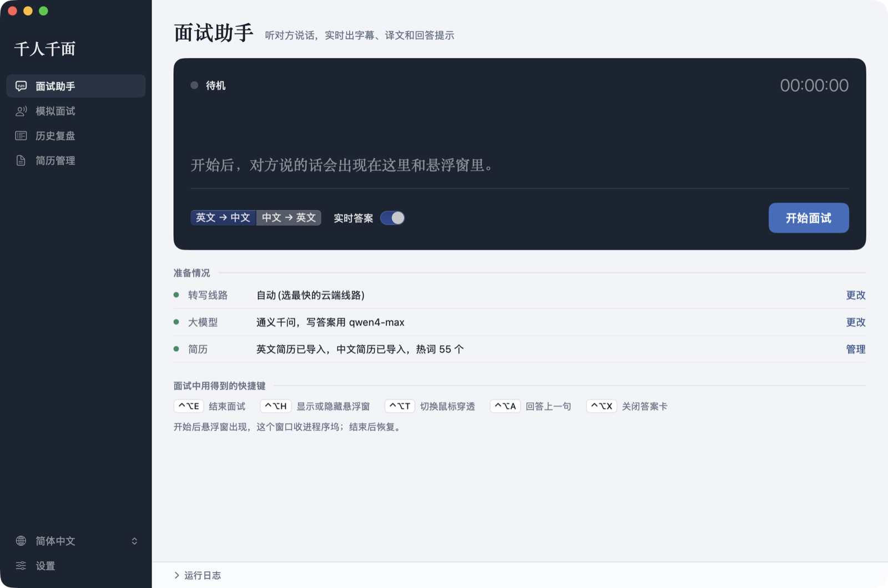
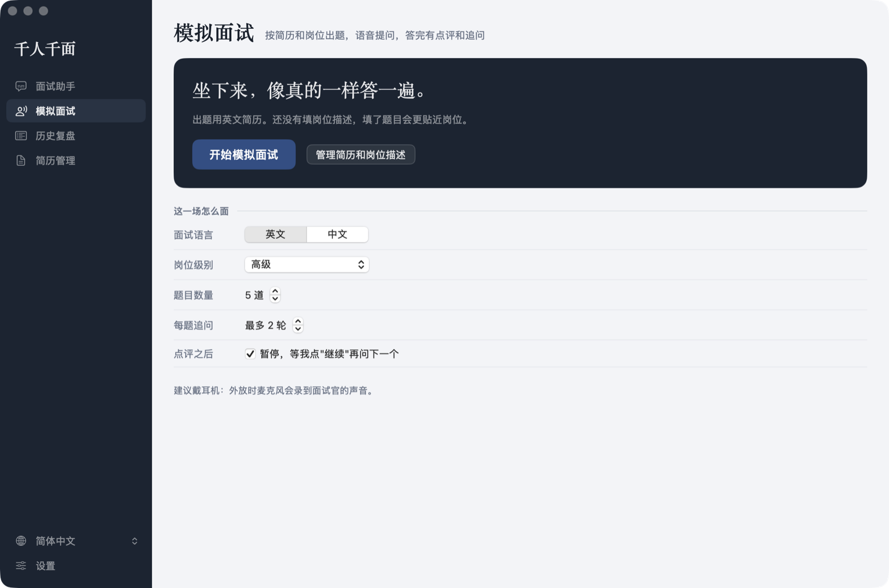
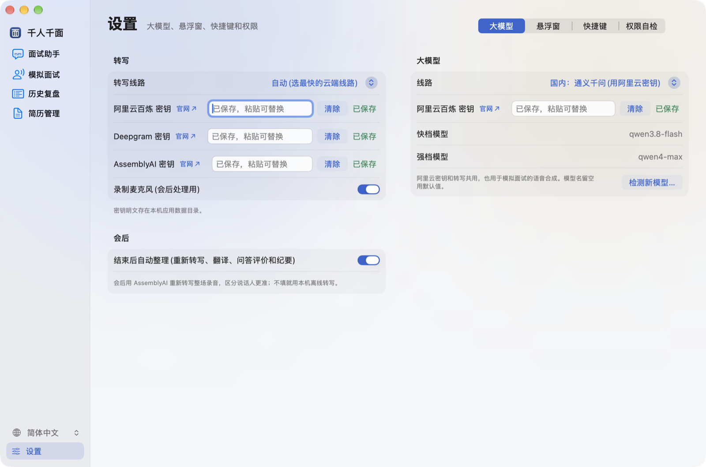

# 千人千面 · InterviewCopilot

开线上面试时陪在旁边的 Mac 助手：实时把对方的话转成字幕并翻译，按你的简历给出回答提示；面试结束后整理出逐题复盘。平时还能跟它来一场模拟面试练手。



## 它能帮你做什么

**面试中**

- **实时字幕和翻译**：采集会议软件里对方的声音，一句一句出原文和译文，支持英文 → 中文、中文 → 英文。
- **悬浮窗**：字幕显示在一个浮在会议窗口上方的小窗里，可以调字号和透明度，可以开启鼠标穿透，屏幕共享和截屏时默认隐藏。
- **回答提示**：听到面试官的问题后，结合你导入的简历和岗位描述给出回答要点。可以自动出，也可以按快捷键让它回答上一句。
- **快捷键**：面试时不用切窗口，默认快捷键如下，都可以改。

  | 快捷键 | 作用 |
  |---|---|
  | ⌃⌥E | 结束面试 |
  | ⌃⌥H | 显示或隐藏悬浮窗 |
  | ⌃⌥T | 切换鼠标穿透 |
  | ⌃⌥A | 回答上一句 |
  | ⌃⌥X | 关闭答案卡 |

**面试后**

- **自动整理**：结束后对整场录音重新转写，分出面试官和你，逐句翻译，把问答配对，给每道题打分、写评价和参考答案，最后生成一份面试纪要。
- **历史复盘**：按时间线回听每一句，对照文字看自己当时怎么答的。可以导出成 Markdown 或 PDF。

**平时练习**

- **模拟面试**：按你的简历和岗位描述出题，用语音提问；你开口回答，答完它会点评并追问。可以选中文或英文、岗位级别、题目数量和追问轮数，结束后同样生成复盘。



**其他**

- **简历管理**：导入中英文两份简历(PDF、Word 或纯文本)，会自动抽出公司名、项目名和技术名词作为热词，让转写更准确地识别这些专有名词。
- **界面语言**：中文和英文，默认跟随系统。
- **权限自检**：一键检查麦克风、系统声音录制、密钥和翻译是否就绪，哪里不对直接告诉你怎么改。

## 系统要求

- macOS 14.2 或更高版本
- Apple 芯片和 Intel 芯片的 Mac 都能用

## 安装

1. 到 [Releases](../../releases) 下载最新版本的 `InterviewCopilot.zip`，解压后把 `InterviewCopilot.app` 拖进「应用程序」文件夹，打开后应用名显示为「千人千面」。
2. 这个应用没有经过苹果公证，第一次打开时系统会提示无法验证开发者。打开「系统设置 › 隐私与安全性」，在页面下方找到 InterviewCopilot，点「仍要打开」。
   也可以在终端运行下面这条命令，之后就能正常双击打开：

   ```bash
   xattr -dr com.apple.quarantine /Applications/InterviewCopilot.app
   ```

3. 第一次开始面试时，系统会询问「系统声音录制」权限，请点允许，不然听不到对方的声音。用到模拟面试或会后整理时，还会询问麦克风权限。

## 开始之前：填好密钥

千人千面本身不收费，转写、翻译和回答提示用的是你自己的云服务账号。打开「设置 › 大模型」，选好线路，在对应的输入框里粘贴密钥即可，每个密钥旁边都有「官网」链接，点开就能申请。



| 用途 | 可选的服务 | 说明 |
|---|---|---|
| 实时转写 | 阿里云百炼、Deepgram、AssemblyAI、本地离线 | 选「自动」会同时连接已填密钥的线路，用最快的那条。本地离线不需要密钥，但延迟高一些。 |
| 回答提示、复盘、模拟面试 | 通义千问(用阿里云百炼的密钥)、Claude | 国内推荐通义千问。设置里的「检测新模型」可以查看还能换哪些模型，包括 DeepSeek 和 Kimi。 |
| 会后重新转写 | AssemblyAI | 区分说话人更准确；不填就用本机离线转写。 |

只想用一个密钥的话，填一个阿里云百炼的就够了：实时转写、回答提示、复盘和模拟面试的语音都能用它。

密钥只保存在你自己的 Mac 上，不会上传到别的地方。

## 用起来

1. 在「简历管理」里导入简历，可以顺便贴上岗位描述。
2. 进入会议后，在「面试助手」页选好翻译方向，点「开始面试」。主窗口会收进程序坞，悬浮窗出现在屏幕上。
3. 面试结束按 ⌃⌥E。主窗口回来，几十秒后就能在「历史复盘」里看到整理好的结果。

## 隐私

- 录音、字幕和复盘都存在本机的应用数据目录里，可以随时在「历史复盘」里删除。
- 转写和大模型请求会发送到你在设置里选择的云服务，不经过任何中间服务器。选择本地离线转写时，声音不会离开你的电脑。

## 许可证

[MIT](LICENSE)：可以自由使用、修改和分发，保留版权声明即可。

---

## English

InterviewCopilot is a macOS companion for online interviews. It transcribes and translates what the interviewer says in real time (English ↔ Chinese), shows captions in a floating window that stays hidden from screen sharing, and suggests answers based on your résumé. After the interview it re-transcribes the recording, scores each answer, writes reference answers and a summary. You can also practice with a voice-driven mock interview.

- Requires macOS 14.2 or later, on Apple silicon or Intel Macs.
- Download the latest build from [Releases](../../releases). The app isn't notarized: on first launch, go to System Settings › Privacy & Security and click "Open Anyway".
- Bring your own API keys (Alibaba Cloud Bailian, Deepgram, AssemblyAI, or Anthropic). A single Alibaba Cloud Bailian key covers transcription, answers, reviews and mock-interview speech. Keys stay on your Mac.
- The interface is available in Chinese and English and follows your system language by default.
- Licensed under the [MIT License](LICENSE).
